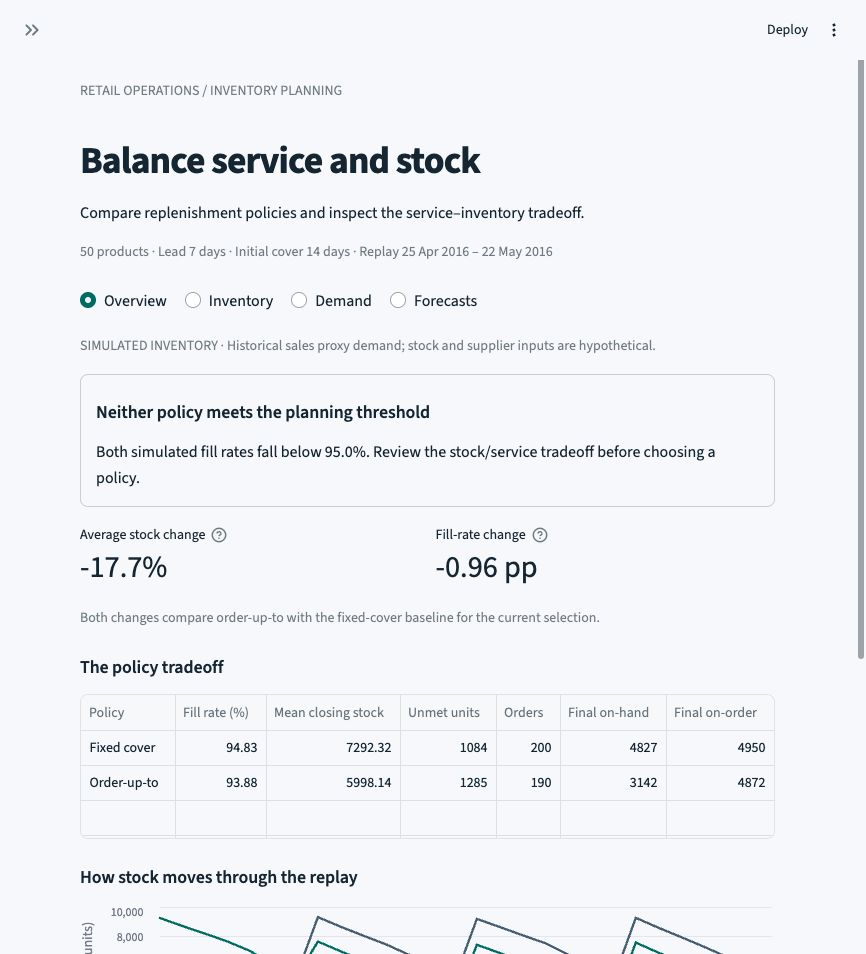
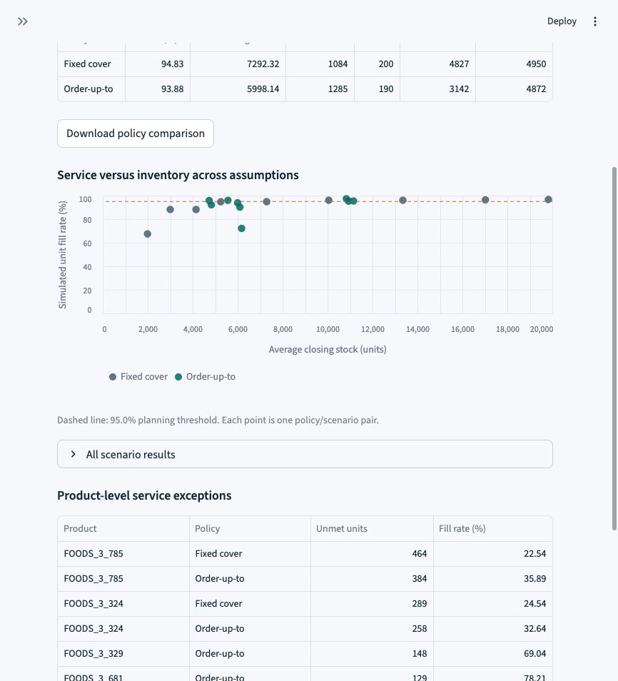
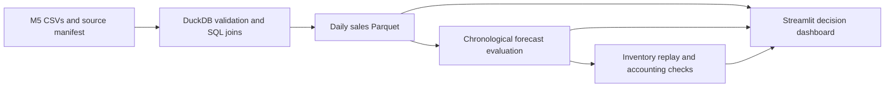

# Inventory Replenishment Analytics

**How much inventory can a retailer release before service becomes unacceptable?**

I built a retail planning case study that connects validated sales data, chronological
forecast evaluation, and inventory-policy simulation in an interactive Streamlit dashboard.

**Python · SQL / DuckDB · pandas · NumPy · Altair · Streamlit**

[**Open the live synthetic demo**](https://pouya-inventory-planning.streamlit.app/) · [M5 findings](#what-i-found)

The live demo uses independently generated data. The findings and screenshots
below come from the separate M5 case study.



## The decision

An inventory planner needs to balance stock against fulfillment. I compare a simple
fixed-cover policy with a forecast-based order-up-to policy, then examine how lead
time and starting stock change the result. A planning threshold makes the service
requirement explicit rather than treating every inventory reduction as a benefit.

The analysis uses M5 retail sales. Inventory, supplier lead times, and starting
stock are hypothetical, so the policy results are **simulated outcomes**, not
measured retailer stockouts or financial savings.

## What I found

In the base scenario—seven-day lead time, weekly reviews, and 14 days of starting
stock cover—the lower-inventory policy also fulfilled fewer requested units.

| Simulated measure | Fixed cover | Order-up-to |
| --- | ---: | ---: |
| Average closing inventory, cohort units | 7,292.3 | 5,998.1 |
| Unit fill rate | 94.83% | 93.88% |
| Unmet units | 1,084 | 1,285 |

Order-up-to held **17.7% less average inventory**, with a **0.96 percentage-point
lower fill rate**. Neither policy met the dashboard's default 95% planning threshold.
There is no monetary objective that would establish an economically optimal choice.

Forecasting produced a second useful result: calendar ridge won validation but the
28-day average won the final period. I retained the model selected before final
scoring rather than switching after inspecting the outcome.

| Forecast | Validation MAE | Final-period MAE |
| --- | ---: | ---: |
| Calendar ridge, validation-selected | 6.101 | 6.060 |
| Recent 28-day average | 6.379 | 5.911 |
| Previous-week pattern | 6.866 | 5.992 |

MAE is units per product-day. See the [forecast findings](docs/FORECAST_RESULTS.md)
and [inventory findings](docs/SIMULATION_RESULTS.md) for the evaluation scope and limits.

## Explore the dashboard

Four views connect the decision to its evidence:

- **Overview:** policy tradeoff and service-threshold interpretation.
- **Inventory:** nine lead-time/starting-stock scenarios, service exceptions, and aggregate export.
- **Demand:** training-period sales patterns and product contributions.
- **Forecasts:** validation/final scores and product-level forecast comparisons.



A distributable **synthetic demo** runs from a clean checkout with no M5 download:

```sh
.venv/bin/python -m streamlit run app/demo_app.py
```

Its 24 invented products demonstrate the same dashboard with different results.
Every view identifies the synthetic data; the findings and screenshots above
remain the M5 analysis. [Open the public demo](https://pouya-inventory-planning.streamlit.app/). The
[deployment guide](docs/DEPLOYMENT.md) records its settings and verification.
The screenshots and results are available here without installing the app. The [dashboard gallery](docs/DASHBOARD_GALLERY.md) contains
the demand and forecast views; the [dashboard guide](docs/DASHBOARD.md) explains filters.

## Data and engineering

The source contains **30,490 product-store sales series** and **6.84 million weekly
price records**, with calendar events and SNAP indicators. The working mart contains
**97,050 product-day observations** for 50 active products at CA_1 / FOODS_3.
Products are selected from the initial training interval, before model comparison.



Source keys, join cardinality, unit totals, and price coverage are checked before
the mart is written. Forecast selection is recorded before final scoring, with
input/code fingerprints. The simulation checks daily stock and demand balance
and cumulative stock/pipeline conservation across **25,200 ledger rows**.

The local suite has **38 passing checks**, including clean-copy synthetic-demo
integration, bundle integrity, and native-report data contracts. GitHub Actions
runs checks on clean Linux checkouts. Raw M5 files, generated M5 marts, and daily
M5 replay records are excluded from Git. The independent synthetic example under
`data/demo/` is distributable and versioned with its hashes.

## Run locally

Python 3.13 was used for the tested macOS environment. Source acquisition downloads
approximately 326 MB; the setup guide explains reuse terms and frozen-input checks.

```sh
python3 -m venv .venv
.venv/bin/python -m pip install -r requirements-lock.txt
.venv/bin/python scripts/download_data.py
.venv/bin/python scripts/build_data.py
.venv/bin/python scripts/backtest.py
.venv/bin/python scripts/evaluate.py
.venv/bin/python scripts/simulate.py
.venv/bin/python -m streamlit run app/streamlit_app.py
```

Run checks with `.venv/bin/python -m unittest discover -s tests -v`.
The three M5 dashboard integration checks skip until the local analysis is built;
public synthetic-demo checks always run. A separate
rebuild from the verified raw inputs reproduced the frozen final evaluation and
all 18 scenario-policy summaries in the tested environment.
[Setup and output details](docs/SETUP.md).

## Walkthrough and limitations

The [technical walkthrough](docs/TECHNICAL_WALKTHROUGH.md) traces one complete run
and explains the key modeling decisions. The [architecture](docs/ARCHITECTURE.md),
[forecast methodology](docs/FORECASTING.md), and [simulation methodology](docs/SIMULATION.md)
provide implementation detail.

The cohort favors active products in one store and department. Sales reflect
fulfilled transactions, not unconstrained demand. The final forecasting period is
now inspected, and the inventory comparison on those days is retrospective.
The short simulation starts without a supplier pipeline or warm-up, and its normal
independent-error safety buffer does not guarantee service. No cost-saving claim is made.

Data: [University of Nicosia M5 record on Zenodo](https://zenodo.org/records/10203108),
linked to the original M5 competition. Access does not establish unrestricted
redistribution rights; see [source and reuse notes](docs/DATA_SOURCES.md).

**Status:** the Python dashboard and publication package are complete.
Native [Power BI project](reports/powerbi/README.md) and
[paginated RDL](reports/paginated/README.md) sources are available. JSON/XSD and
extract reconciliation checks pass; native refresh, rendering, and exports remain
unverified. See the [validation record](reports/VALIDATION.md) and
[milestones](docs/MILESTONES.md).

Code and the independently generated synthetic example are available under the
[MIT license](LICENSE). M5 input data remains subject to its own source terms.
