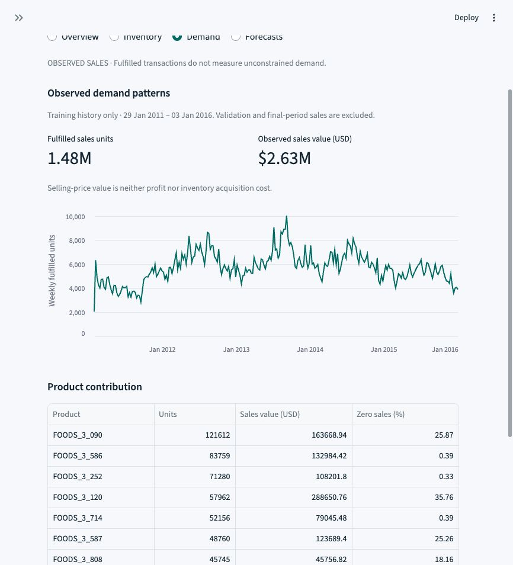
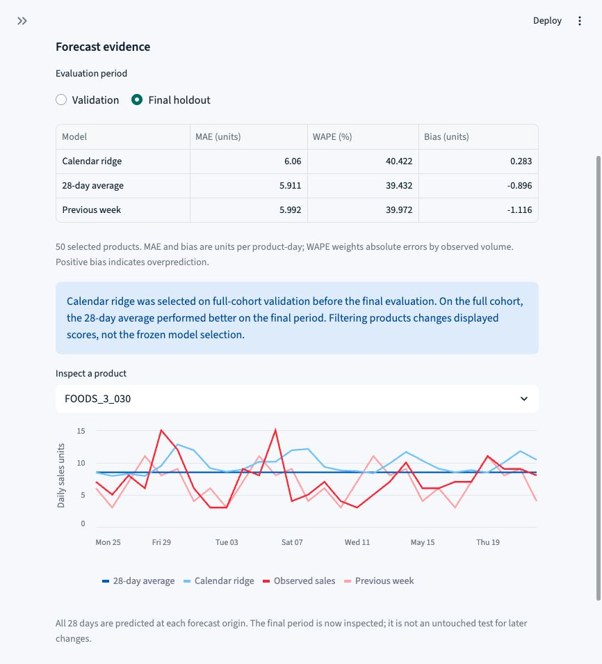

# Dashboard gallery

Actual captures from the local Streamlit application, taken on 2026-10-19.
The selected cohort is all 50 products. The inventory context is a seven-day lead
time, weekly reviews, 14 days of initial cover, and a 95% planning threshold.
The captures show the unaltered browser viewport at different scroll positions;
no values or charts have been redrawn. The gallery is a static preview, not a hosted application.

## Overview: interpret the tradeoff

The lower-inventory policy has lower simulated service. Neither policy qualifies
at the default threshold, so the summary does not recommend one merely because
it holds less stock.

## Inventory: compare assumptions

Each point represents a policy/scenario pair. The dashed line is the planning
threshold; it does not resize the safety buffer or optimize the policies.

## Demand: inspect observed sales

Training history is kept separate from the validation/final periods. Selling-price
value is not profit, and zero-sales runs cannot identify stockouts.

## Forecasts: compare the final period

Calendar ridge was selected from validation before final scoring. The recent
average performed better on the final period; the selection remains unchanged.

See the [dashboard guide](DASHBOARD.md) for filters and the
[technical walkthrough](TECHNICAL_WALKTHROUGH.md) for the analytical sequence.
